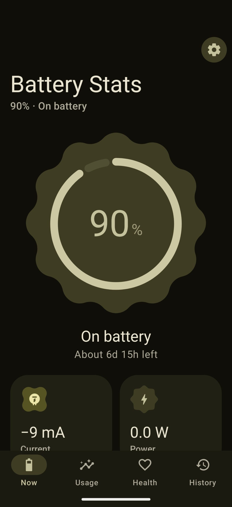
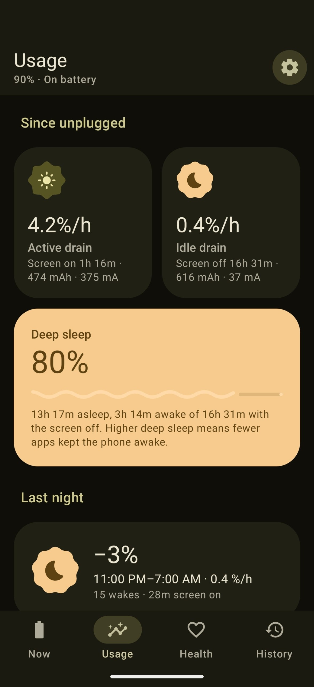
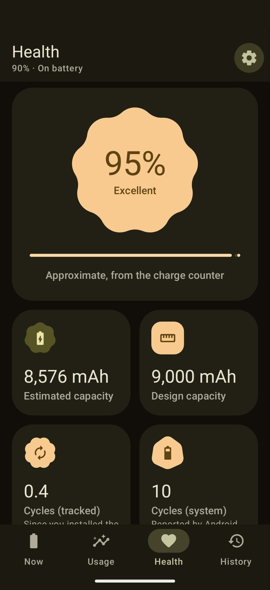
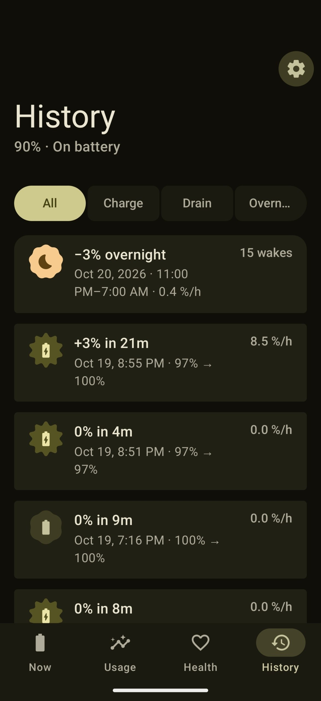
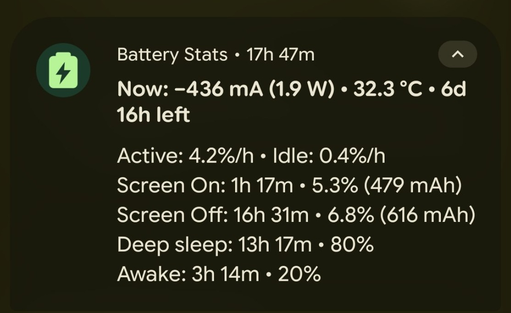

# Battery Stats

A battery monitor for Android. It shows the current going in or out of your battery, how fast it drains with the screen on and off, how much your phone sleeps, and how much capacity your battery has left.

Free and open source. No ads, no accounts, no internet permission.

<p>
  
  
  
  
</p>


## What it does

- Current (mA), power (W), voltage and temperature, updated every few seconds
- Time left until full or empty
- Active drain (screen on) and idle drain (screen off) in % per hour
- Deep sleep and awake time while the screen is off
- A notification with all of the above, and the level, current, temperature or power in the status bar
- A morning report of how much the battery dropped overnight and how often the screen came on
- Battery health, worked out from how much charge goes in when you charge
- History of every charge and discharge
- Alarms for a charge limit (80% by default) and low battery
- Battery level chart for the last 24 hours

Health needs a few charges of 30% or more before it shows a number. If your phone reports the wrong design capacity, set the right one in Settings.

Needs Android 12 or newer.

## Install

Download the APK from [Releases](https://github.com/ghanishftw/batterystats/releases), or add this repo's URL to [Obtainium](https://github.com/ImranR98/Obtainium) to get updates automatically.

## Build

```sh
./gradlew :app:assembleRelease
```

Release builds are always signed. Put your key details in a `keystore.properties` file in the project root (it's git-ignored):

```properties
storeFile=release.jks
storePassword=...
keyAlias=...
keyPassword=...
```

or set `KEYSTORE_FILE`, `KEYSTORE_PASSWORD`, `KEY_ALIAS` and `KEY_PASSWORD` as environment variables.

If you really want an unsigned APK, for example on F-Droid's build server, pass `-PallowUnsigned=true`.

GitHub Actions runs the tests and builds a signed APK on every push. Pushing a tag like `v1.0` (or `1.0`) makes a release with the APK attached.

## License

[GPL-3.0](LICENSE)
